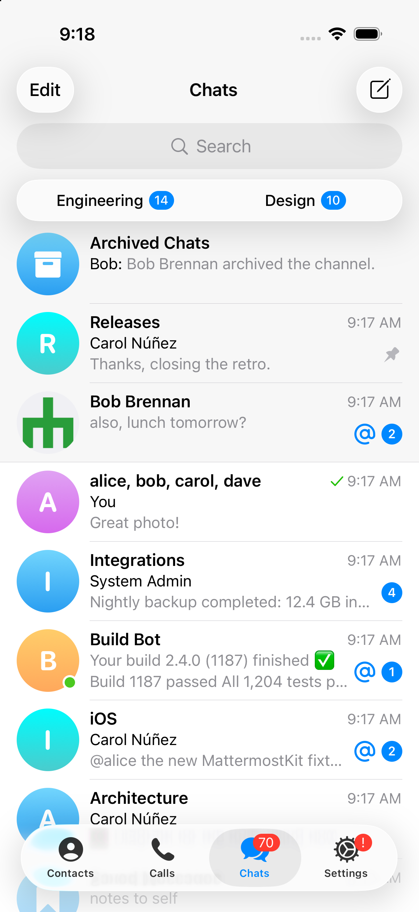
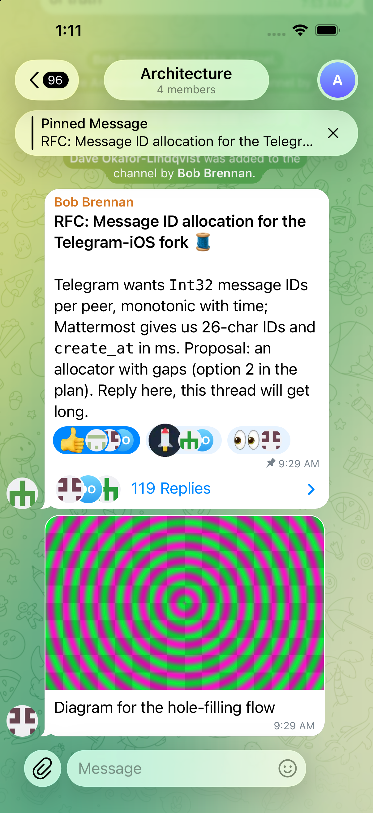
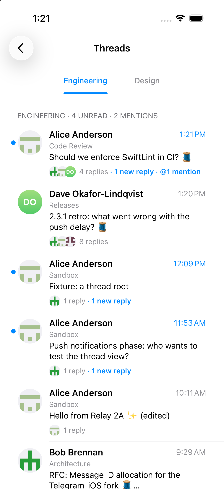
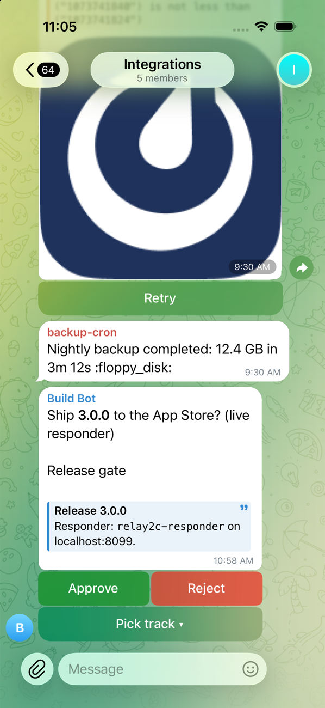

# Relay

A native iOS client for [Mattermost](https://mattermost.com), built as a fork of [Telegram‑iOS](https://github.com/TelegramMessenger/Telegram-iOS). It keeps Telegram's fast, polished UI and local database, and replaces Telegram's networking with Mattermost's REST API v4 and WebSocket.

> **Unofficial.** Relay is not affiliated with, endorsed by, or connected to Telegram or Mattermost. "Relay" is a working name.

<p>
  
  
  
  
</p>

## Status

Development build, not yet distributed. See [docs/PROGRESS.md](docs/PROGRESS.md) for the detailed log.

| Area | State |
|---|---|
| Login (password, MFA; SSO implemented but unverified), several servers/accounts, logout, session expiry | Done |
| Chat list with team folders, favorites, unread and mention badges, archived and muted channels | Done |
| History (full paging, permalinks), live updates over WebSocket, catch-up after reconnect | Done |
| Sending text, replies, images, files, albums; edit, delete, reactions, typing | Done |
| Collapsed reply threads, Threads list, follow/unfollow | Done |
| Message attachments with buttons and menus, interactive dialogs, slash commands | Done |
| @mentions, ~channels, :emoji: autocomplete; custom emoji | Done |
| Search, recent mentions, saved posts, pinned messages, file search | Done |
| Directory, channel creation and settings, membership management | Done |
| Link previews, markdown blocks, in-app permalinks, `relay://` links | Done |
| Status, custom status, profile editing, notification preferences | Done |
| Push notifications (own push proxy) | Done; real delivery needs an APNs key |
| Share extension | Done |
| Release hardening, performance, accessibility | In progress |
| TestFlight / App Store | Needs an Apple Developer account |

Requires Mattermost server **11.7** or newer.

## How it works

Telegram's UI reads everything from **Postbox**, its local database, and calls a small engine API for actions. Relay keeps both and swaps what's underneath:

- a **null network engine** that never talks to Telegram, so no MTProto connection is ever made;
- **MattermostKit**: REST v4 and WebSocket client (Foundation only);
- **MattermostSyncCore**: message‑ID allocation, markdown → text entities, mapping rules, an SQLite sync store;
- **MattermostSync**: writes Mattermost data into Postbox and replaces Telegram's background operations (sending, history loading, read state, reactions, and so on);
- **MattermostUI**: login, directory, settings and other Mattermost‑only screens.

Upstream edits are kept small and marked `// MATTERMOST:`. Background and design: [PLAN.md](PLAN.md), [docs/plan/](docs/plan/), [docs/design/mattermost-sync.md](docs/design/mattermost-sync.md), [docs/research/telegram-internals.md](docs/research/telegram-internals.md).

## Building

Pinned to Telegram‑iOS upstream commit `5c20d095` (tag `upstream-pin`) and **Xcode 27.0**. See [docs/BUILD.md](docs/BUILD.md) for the exact commands, the simulator setup and the debug hooks. A local Mattermost server with seed data is in [infra/dev-server/](infra/dev-server/README.md); the push proxy is in [infra/push-proxy/](infra/push-proxy/README.md).

The Swift packages build and test on their own:

```sh
cd submodules/MattermostKit && swift test
cd submodules/MattermostSyncCore && swift test
```

## License

Relay is built from Telegram‑iOS, whose source is published under the GNU GPL. Relay's source is published here under the same terms; see [docs/plan/08-legal-and-licensing.md](docs/plan/08-legal-and-licensing.md) for the open licensing questions. Telegram's original README, including its requirements for apps built from its source, is kept at [docs/upstream/TELEGRAM-README.md](docs/upstream/TELEGRAM-README.md). Third‑party notices are listed in the app under About → Open Source Licenses.
